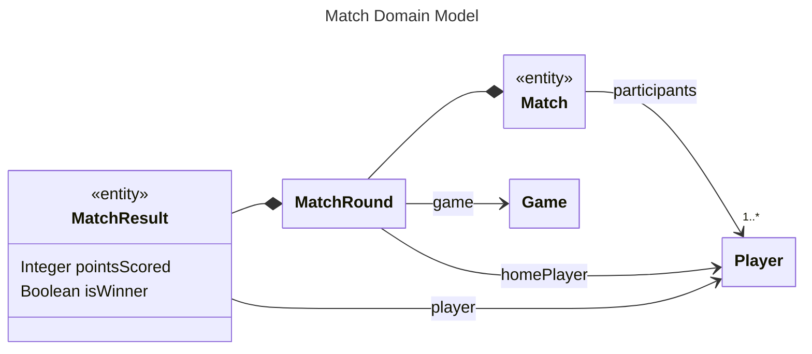

| Class       | Type   | Description                                              |
|-------------|--------|----------------------------------------------------------|
| Match       | Entity | An arrangement between two or more players to play Games |
| MatchRound  | Entity |                                                          |
| MatchResult | Entity |                                                          |
