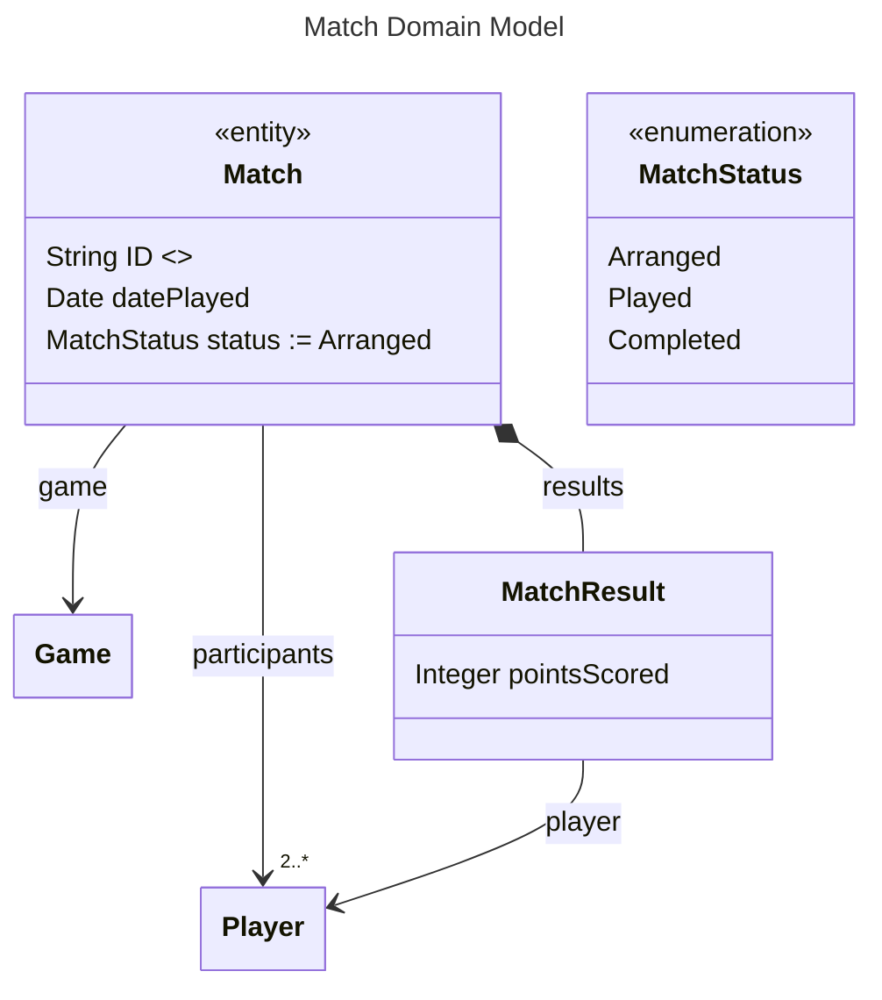

#   Match Domain Model 

Validation Rules:
-    Each Match::participants::ID is unique 
-    Each Match::results::ID is unique
-    Each Match::results::player is in Match.participants
-    When number of Match::results is 0 then Match.status is Arranged
-    When number of Match::results is greater than 0 then  Match.status is Played
-    When number of Match::results equals number of Match::participants then Match.status is Completed.
