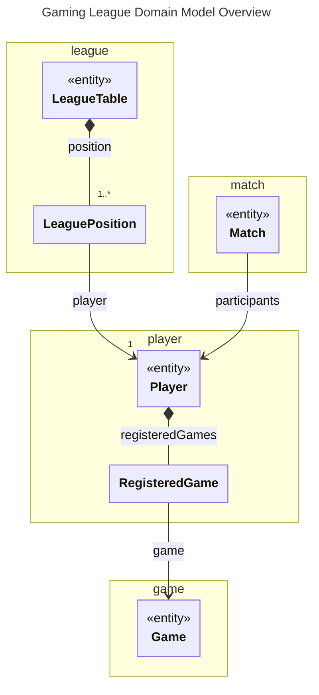

#   Gaming League Integrated Domain Model Overview

| Namespace        | Root Entity | Description                                                                           |
|------------------|-------------|---------------------------------------------------------------------------------------|
| [Game](game)     | Game        | The Game domain contains the definition of a game and its type.                       |
| [Player](player) | Player      | The Player domain contains the definition of a player and their attributes.           |
| [Match](match)   | Match       | The Match domain contains the definition of a match and its details.                  |
| [League](league) | LeagueTable | The LeagueTable domain contains the definition of the league table and its structure. |
