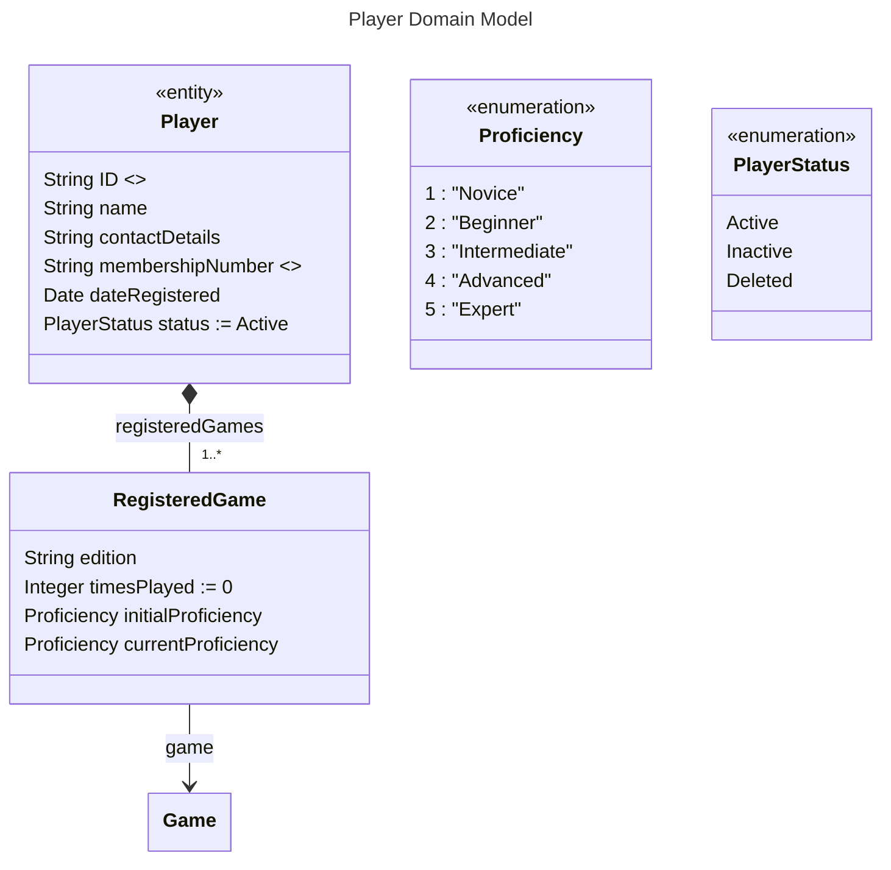
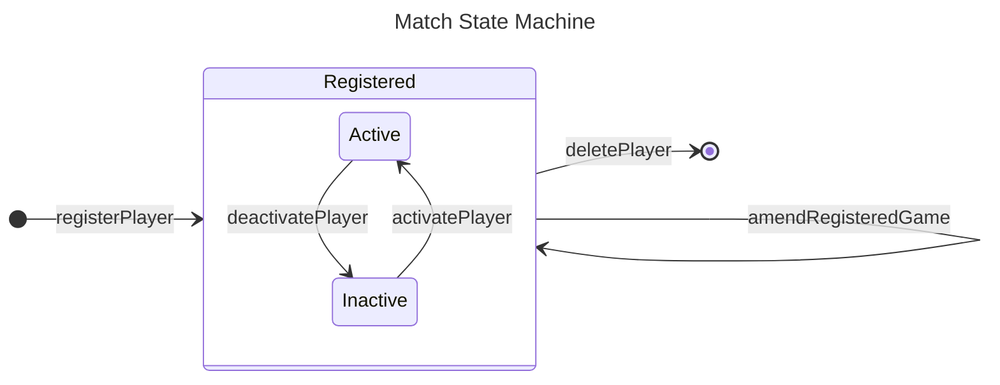

#    Player Domain Model

##  State Machine

| operation             | Summary of operation                                                                                                                                                                    |
|-----------------------|-----------------------------------------------------------------------------------------------------------------------------------------------------------------------------------------|
| Register Player       |                                                                                                                                                                                         |
| Amend Registered Game | adds or removed a Game from the Player's Registered Games list. It does **not** amend the details of the Registered Game itself.                                                        |
| Delete Player         | Removes a Player from the Player dataset only if they have not played a Match. Players that have played a Match are recorded as "Deleted" and not physically removed frpom the dataset. |
| Deactivate Player     |                                                                                                                                                                                         |
| Activate PLayer       |                                                                                                                                                                                         |